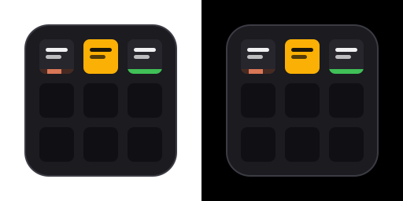

# Claude Code sessions on the Logitech MX Creative Keypad

A Logi Options+ plugin that puts your running [Claude Code](https://claude.com/claude-code) sessions on the
LCD keys of the **MX Creative Keypad** – what each session is doing, which one needs you – and jumps to a
session's terminal with one press.

<p align="center"></p>

> Unofficial community plugin. Not affiliated with or endorsed by Anthropic or Logitech.

## What the keys show

Each **Claude Session 1–9** key shows one session: its name (set with `/rename`, otherwise the title Claude
Code generates) and its state.

| State | Key |
|---|---|
| **working** – Claude is thinking or running tools | dark key, status in coral, a bar sweeping along the bottom |
| **waiting** – needs your approval, an answer or a plan review | the whole key turns amber and pulses |
| **done** – the turn finished | green status and bar, until you press the key |
| **error** – the turn failed | red status and bar |
| **ready** – idle, interrupted with Esc, or after a slash command | muted grey |
| no session | black |

Pressing a key brings the session's terminal to the front and clears a *done*/*error* marker.
**Next waiting session** shows how many sessions wait for you and jumps to the one waiting longest.

Sessions keep their key while they run; a session whose `claude` process is gone is cleaned up automatically.
Texts are English, or German when Logi Options+ runs in German.

### Jumping to the session

| Where the session runs | What a press does |
|---|---|
| iTerm2 | selects the exact window, tab and split pane |
| Terminal.app | selects the exact window and tab |
| PhpStorm / other JetBrains IDEs, VS Code, … | raises the project window whose title names the session's folder |
| Ghostty, WezTerm, Warp | activates the app |

On the first press macOS asks whether *LogiPluginService* may control iTerm2, Terminal or System Events –
allow it. Raising IDE windows also needs *LogiPluginService* under
*System Settings → Privacy & Security → Accessibility*.

## Install

1. Install the plugin – from the Logitech Marketplace in Logi Options+, or download
   `ClaudeStatus_x_y.lplug4` from [Releases](../../releases) and double-click it.
2. In Logi Options+, open the MX Creative Keypad, go to *All actions → Installed plugins →
   Session Status for Claude Code* and drag **Claude Session 1–9** (and optionally **Next waiting session**)
   onto keys.
3. Start new Claude Code sessions (running sessions pick the hooks up as well).

## Setup

The plugin sets up the Claude Code hooks it needs by itself, when it is installed:

- it writes the hook script to `~/.claude/hooks/claude-mx-keypad.sh`
- it adds one entry per event to `"hooks"` in `~/.claude/settings.json` (`SessionStart`, `UserPromptSubmit`,
  `PreToolUse`, `PostToolUse`, `PermissionRequest`, `Notification`, `Stop`, `StopFailure`, `PreCompact`,
  `SessionEnd`) – nothing else in the file is touched, and a backup is saved as
  `settings.json.bak-claude-mx-keypad` before the first change

Uninstalling the plugin removes exactly these entries and the script again. If you remove the hooks yourself,
the plugin does not add them back; it shows a warning in Logi Options+ instead. To set them up again, reinstall
the plugin.

Requirements: macOS, Logi Options+ with an MX Creative Keypad, Claude Code. The hook is plain `bash` – no
`jq`, Python or Node needed.

## How it works

```
Claude Code ──hook events──▶ ~/.claude/hooks/claude-mx-keypad.sh ──▶ ~/.claude/keypad/<session>.json
                                                                              │
Logi Options+ ◀── key images ── Logi plugin (C#) ◀── file watcher ───────────┘
                                         └── reads the session transcript (name, end of turn)
```

- The **hook** turns events into a small status file per session: `UserPromptSubmit`/tool use → working,
  `PermissionRequest`/questions → waiting, `Stop` → done. Tool calls made by plugins outside a turn
  (`toolu_plugin_…`) are ignored. It also records the session's process, terminal tab and host app.
- The **plugin** watches those files, reads each session's name from its transcript, and double-checks the
  end of the turn there – Esc fires no `Stop` hook, so an interrupted turn would otherwise stay "working".

Everything stays on your Mac – no network access, no data collection.

## Troubleshooting

- Plugin log: `~/Library/Application Support/Logi/LogiPluginService/Logs/plugin_logs/ClaudeStatus.log`
- Status files: `~/.claude/keypad/*.json`
- Trace every hook event: `touch ~/.claude/keypad/.debug`, then watch `~/.claude/keypad/debug.log`
  (remove `.debug` to stop)

## Development

```bash
# .NET 10 SDK and the Logi Plugin Tool
dotnet tool install --global LogiPluginTool

cd ClaudeStatusPlugin
dotnet build              # Debug: links the build into Logi Plugin Service and reloads it
dotnet build -c Release   # then package:
logiplugintool pack ./bin/Release/ ../dist/ClaudeStatus_1_0.lplug4
logiplugintool verify ../dist/ClaudeStatus_1_0.lplug4
```

Pushing a tag `v*` builds, verifies and attaches the `.lplug4` to a GitHub release.

Code map: `src/Resources/claude-mx-keypad.sh` (hook), `src/Setup/HookInstaller.cs` (settings.json),
`src/Sessions/` (status files, transcripts, key rendering, terminal focus), `src/Actions/` (the key actions).

## License

[MIT](LICENSE)
